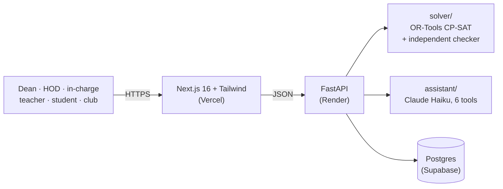

# College Timetable

**One place for the whole college.** The Dean's office generates a clash-free timetable in minutes. Everyone signs in with their own username and password and sees only their own pages. Departments prepare and approve their own data, teachers ask for leave and get covered, students see what's on now and next, and clubs book rooms with digital approval instead of paper letters.

**Live demo:** <https://college-timetable-teal.vercel.app>. The first visit may take up to a minute while the free server wakes up.

Built for the Punjab Jobs AI Bootcamp hackathon (J-PAL South Asia). It works for any college: nothing about days, periods, breaks, rooms or departments is hard-coded.


**Contents:** [Try it](#try-it-sign-in-as-each-person) · [Who it's for](#who-its-for) · [What it does](#what-it-does) · [How a Dean uses it](#how-a-dean-uses-it-in-5-steps) · [Screenshots](#screenshots) · [How it's built](#how-its-built) · [Run it locally](#run-it-locally) · [Deploy](#deploy) · [Limitations](#limitations-and-roadmap)

## Try it: sign in as each person

Open **Sign in** on the live site. Under **"Evaluators: try it as"**, pick a person: their sign-in shows in grey in the boxes, so just press **Sign in**.

| Sign in as | Username | Password | What to try |
|---|---|---|---|
| **Dean** (super admin) | `dean` | `demo1234` | **Today** (what needs doing), all timetables, Setup (change data, generate again, publish), People & sign-ins, Reports, room approvals |
| **HOD** of CSE | `hod` | `demo1234` | Approve CSE's timetable data (or send it back with a note), approve leave and arrange cover, room requests, make the in-charge's sign-in |
| **Timetable in-charge** of CSE | `incharge` | `demo1234` | Edit only CSE's rooms, teachers, sections and classes, then send them to the HOD |
| **Teacher** (Dr. Kulwinder Singh Mann) | `teacher` | `demo1234` | Today's classes, their week, ask for leave, book a room |
| **Student** (CSE-3A) | `student` | `demo1234` | "Now / Next", their section's week, today's changes, add it to their phone's calendar |

College code: **`4H7GM5`**, the demo college *Guru Nanak Institute of Technology, Ludhiana*, built from [docs/New_College_Data.xlsx](docs/New_College_Data.xlsx) (3 departments, 23 teachers, 8 sections, Monday to Saturday with a short Saturday, open electives).

These demo sign-ins are public and open only the demo college. If someone changes it, `python backend/seed_demo.py https://college-timetable-api.onrender.com` makes a fresh one; put its code in `frontend/lib/demo.ts`.

### Test it from scratch in 10 minutes

1. **Sign out** (your name at the top right → Sign out). On the home page choose **New college? Set it up**.
2. Pick **Engineering**, then **Excel → Import workbook** and choose [docs/New_College_Data.xlsx](docs/New_College_Data.xlsx). Look through the steps; change anything you like.
3. **Check & generate → Generate timetable** (up to about a minute on the free server). You get "Verified: 0 clashes".
4. **Save online & share**, then choose your Dean username and password. On **Timetables**, press **Publish timetable**.
5. On **People & sign-ins**, make an HOD, a teacher and a student (or paste students as "roll number, name, section"). Write down the passwords: they're shown once.
6. Sign out and sign in as each of them: everyone lands on their own page and sees only their own links.
7. To start again: **Setup → Start a new college**. To take a timetable down: **Timetables → Unpublish** or **Delete this timetable**.

## Who it's for

| Person | Where they land | What they get |
|---|---|---|
| **Dean** (super admin) | **Today** | A to-do list (publish, leave waiting, classes needing cover, bookings waiting); a 6-step setup or one Excel workbook; a timetable with **0 clashes, checked twice**; plain-English reasons when something can't fit; one click to publish; everyone's sign-ins; reports |
| **HOD** | **HOD page** | Approves the department's data before the Dean generates, approves leave and arranges cover, decides room requests, makes the timetable in-charge's sign-in |
| **Timetable in-charge** | **Department** | Edits only their department's rooms, teachers, sections and subjects, and sends them to the HOD |
| **Teacher** | **Teacher page** | Their own week, today's classes, leave requests and room bookings |
| **Student** | **My timetable** | Their section's week, a "Now / Next" card and today's changes. Nothing to change, nothing else to see. |
| **Clubs and organisers** | **Book a room** (no account) | Book a seminar hall or room in a free slot, follow the approval on a tracking link, see the events calendar |

Each person's top bar shows only their own pages, and the server checks every request, so nobody can open someone else's page.

## What it does

- **Zero clashes, verified.** Google OR-Tools (CP-SAT) places every class so no teacher, section or room is ever double-booked. Labs are blocks of consecutive periods in the right lab, every room is big enough, and teachers' unavailable times are respected. An **independent checker** that shares no code with the solver re-checks every timetable, and its result is shown as **"Verified: 0 clashes"**.
- **Good timetables, not just valid ones.** A quality score keeps each subject spread across the week, avoids free periods between classes for students, limits long teaching runs, and balances teachers' days. Every part of the score is explained in plain words.
- **Any college.** Pick a starting template (Engineering, Arts & Science, or from scratch) and then choose:
  - your own working days (5-day or 6-day presets) and periods;
  - lunch and an optional tea break (and whether labs may run across it);
  - periods of different lengths, and shorter days (e.g. a half-day Saturday);
  - your own room types.
- **Fast data entry.** Spreadsheet-style tables with paste-from-Excel, one Excel workbook for everything, row-by-row error messages, and codes that rename everywhere at once. Importing the workbook again can replace the setup with the corrected file.
- **Explains what's wrong.** If no timetable is possible, it says exactly which resource is short and how to fix it, for example *"No classroom can hold the 66 students of Basics of IoT… Ask another department's HOD to share a big enough room."*
- **Open electives.** Students of several sections choose parallel subjects that run at the same time, each with its own teacher and room.
- **Lab batches.** Split a section into lab batches (e.g. A1 and A2) that do labs separately, even at the same time in different labs.
- **Room sharing between departments**, approved by the room's HOD, which the solver then uses.
- **Fair workload.** An optional "max periods a week" per teacher, and a warning when someone teaches far more than their department's average.
- **Sign in for everyone.** The Dean, HODs, timetable in-charges, teachers and students each have a username and password, and see only their own pages. The Dean makes everyone's sign-ins: one at a time, all teachers at once, or students pasted from Excel. The Dean can also reset or remove them, and anyone can change their own password. Passwords are stored only as scrypt hashes, and 5 wrong tries lock a sign-in for 5 minutes.
- **Departments approve their own data.** The in-charge sends the department's data to the HOD, who approves it or sends it back with a note. The Dean generates once every department is approved, or chooses "Generate anyway". Each department can edit only its own rows, and the server enforces it.
- **Change anything, any time.** Edit or re-import the data, generate again and republish as often as you like. Autosave never overwrites newer work from another device or department. You can also unpublish or delete a timetable, or start a new college.
- **Timetable views** by section, teacher and room, on a printable A4 page, and as a day-by-day list on phones. A student's **Today** card shows what's on now and next.
- **Room booking with digital approval.** Only free slots are offered. A teacher's request goes to their HOD, then the Dean; a club's request goes to the Dean. The organiser follows it on a tracking link, and approved events appear on a calendar.
- **Leave and daily changes.** A teacher asks for leave; their HOD approves it and picks a substitute from a ranked list (teaches the subject → same department → anyone free, fewest classes that day first). Cancelled and extra classes too. Students and teachers see today's changes on their own page, and every change is clash-checked.
- **Reports and exports.** Each teacher's weekly load against their department's average, rooms that are hardly used, and each section's free periods. Download every timetable as one Excel file, or add your own week to Google or Apple Calendar.
- **Ask the timetable.** A chat box on My timetable and Timetables answers questions like "Where is my next class?" or "Which rooms are free now?". It uses Claude (Haiku), called only from the backend, with 6 tools over the real timetable and today's changes, so it answers only from real data. It's optional: set `ANTHROPIC_API_KEY` on the server; without it, the box is hidden.

## How a Dean uses it, in 5 steps

1. **Start:** open the site → **New college? Set it up** → pick a template (or **Load sample college** to try it).
2. **Enter the college:** days, periods and breaks, then rooms, teachers, sections, subjects and *who teaches what*. Type, paste from Excel, or import the workbook. HODs and in-charges can also enter and approve their own department's part.
3. **Check & generate:** fix anything the checks point out (each problem has a "Fix in…" button), then press **Generate timetable**. You get "Verified: 0 clashes".
4. **Review:** look at every section, teacher and room, read the quality score, and print if you like.
5. **Save online & publish:** choose your username and password, press **Publish timetable**, and give everyone their sign-in on **People & sign-ins**.

## Screenshots

| Setup (desktop) | Department in-charge (phone) | My timetable (phone) |
|---|---|---|
|  |  |  |

| Timetables | Book a room | Events calendar |
|---|---|---|
|  |  |  |

## How it's built



| Part | Technology | Where |
|---|---|---|
| Frontend | Next.js 16 (App Router), React, TypeScript (strict), Tailwind CSS v4, SheetJS for Excel in the browser | `frontend/`, on Vercel |
| Backend | Python 3.14, FastAPI, SQLAlchemy, Pydantic | `backend/app/`, on Render |
| Timetable engine | Google OR-Tools CP-SAT, plus an independent checker and a diagnoser | `backend/solver/` (pure: no web or database code) |
| Assistant | Claude Haiku with tool use, backend only | `backend/assistant/` (pure) |
| Database | Postgres on Supabase (SQLite locally) | via `DATABASE_URL` |

- **The solver is a pure module**: college data goes in, a timetable comes out. Hard rules are constraints; preferences are weighted penalties.
- **Sign-in:** passwords are stored only as scrypt hashes. Each staff account seals its access key with the password, so signing in gives the browser exactly the key the server checks for that role. Students need no key: the published timetable is public.
- **The full architecture** (every part, the data model, access rules and each main flow as a diagram): **[docs/ARCHITECTURE.md](docs/ARCHITECTURE.md)**.
- More: [context.md](context.md) (design and decisions), [progress.md](progress.md) (build log), [CLAUDE.md](CLAUDE.md) (conventions), [docs/DEMO_TESTCASES.md](docs/DEMO_TESTCASES.md) (22 demo test cases).

## Run it locally

```bash
# Backend: http://localhost:8000 (API docs at /docs)
cd backend
python3 -m venv .venv && .venv/bin/pip install -r requirements-dev.txt
cp .env.example .env
.venv/bin/python -m uvicorn app.main:app --reload --port 8000
```

```bash
# Frontend: http://localhost:3000
cd frontend
npm install
cp .env.local.example .env.local
npm run dev
```

Without `DATABASE_URL`, the backend uses a local SQLite file. To try the sign-ins locally, make a demo college with `cd backend && .venv/bin/python seed_demo.py http://localhost:8000` and put its code in `NEXT_PUBLIC_DEMO_LOGINS` (see [Configuration](#configuration)).

### Tests

```bash
cd backend && .venv/bin/python -m pytest -q          # 97 tests: solver, checker, API, sign-in, departments, bookings, leave, assistant
cd frontend && npm run lint && npm run build
cd frontend && npx playwright install chromium && npm run e2e   # 16 real-browser tests
```

The end-to-end tests click through the app in a real browser:
- load the sample → generate → "Verified: 0 clashes"; Save online → the Dean picks a sign-in → publish → a student opens the share link on a phone;
- a club books a room → the Dean approves → it appears on the events calendar;
- the in-charge sends a department's data → the HOD returns it with a note → it's sent again → approved → the Dean generates;
- lab batches and a short Saturday; reports, the Excel export and the calendar file;
- every page fits a desktop and a 375 px phone screen.

`UPDATE_SCREENSHOTS=1 npm run e2e` refreshes the screenshots in this README.

## Deploy

The backend goes on **Render** (free) and the frontend on **Vercel** (free). Order matters: Render first, because Vercel needs its URL, then back to Render to allow the Vercel URL.

### Configuration

| Where | Variable | Purpose |
|---|---|---|
| Vercel | `NEXT_PUBLIC_API_URL` | The Render URL, without a trailing `/`. Baked in at build time. |
| Vercel | `NEXT_PUBLIC_DEMO_LOGINS` | Optional. JSON `{"code": "...", "logins": [{"role", "label", "username", "password"}]}` to override the evaluator demo sign-ins. |
| Render | `FRONTEND_ORIGINS` | Comma-separated CORS origins: the Vercel URL (and `http://localhost:3000` for development). |
| Render | `DATABASE_URL` | Supabase **Session pooler** URI. Unset = SQLite, which Render wipes on restart. |
| Render | `SOLVER_WORKERS` | CP-SAT search threads. `render.yaml` sets 2 for the free plan. |
| Render | `ANTHROPIC_API_KEY` | Optional. Turns on "Ask the timetable". |

Secrets (`DATABASE_URL`, `ANTHROPIC_API_KEY`) go only in Render's Environment page, never in the code or in a `NEXT_PUBLIC_` variable.

### 1. Backend on Render
1. Go to <https://dashboard.render.com> and sign in with GitHub.
2. Click **New +** → **Blueprint**.
3. Under **Connect a repository**, pick `njain05/hackathon_1`. If it isn't listed (the repo is private), click **Configure account** / **Connect GitHub**, allow access to `hackathon_1`, and come back.
4. Render reads `render.yaml` and shows one service, **college-timetable-api** (free, Singapore). It asks for two values:
   - `FRONTEND_ORIGINS`: type `http://localhost:3000` for now. You'll replace it in step 3.
   - `DATABASE_URL`: your Supabase connection string. Use the **Session pooler** URI from Supabase → Project → **Connect** (Render can't reach Supabase's direct, IPv6-only address). If you don't have Supabase yet, type `sqlite:///./timetable.db` (works, but data is wiped whenever Render restarts).
5. Click **Apply**. The first build takes a few minutes (it installs OR-Tools).
6. When it says **Live**, copy the URL at the top, e.g. `https://college-timetable-api.onrender.com`.
7. Check it: open `<that URL>/health` in a browser. You should see `{"status":"ok"}`.

### 2. Frontend on Vercel
1. Go to <https://vercel.com/new> and sign in with GitHub.
2. Under **Import Git Repository**, find `hackathon_1` and click **Import**. If it isn't listed, click **Adjust GitHub App Permissions** and allow the repo.
3. **Root Directory**: click **Edit** and choose `frontend`. The framework shows **Next.js** automatically.
4. Open **Environment Variables** and add:
   - Name `NEXT_PUBLIC_API_URL`, value your Render URL from step 1.6, **without** a trailing `/`.
5. Click **Deploy**. When it finishes, copy your site URL, e.g. `https://your-project.vercel.app` (shown under **Domains**).

If you forget the variable, the Vercel build stops with "NEXT_PUBLIC_API_URL is not set" on purpose. Add it under **Settings → Environment Variables**, then **Deployments → ⋯ → Redeploy**. The value is baked in at build time, so any change to it needs a redeploy.

### 3. Let the frontend talk to the backend
1. Back on Render, open **college-timetable-api** → **Environment**.
2. Edit `FRONTEND_ORIGINS` and set it to your Vercel URL from step 2.5, starting with `https://`, without a trailing `/`. To also keep local development working, use a comma: `https://your-project.vercel.app,http://localhost:3000`.
3. Click **Save, rebuild, and deploy**.

### 4. Check the live site
1. Open the Vercel URL. The home page badge should say **Server connected** (the first visit may show "Waking up the server" for up to a minute).
2. **New college? Set it up → Load sample college → Check & generate → Generate timetable**. You should land on the timetables with **Verified: 0 clashes**.
3. For the evaluator demo sign-ins, run `python backend/seed_demo.py <Render URL>` and put the printed college code in `frontend/lib/demo.ts`.

### Good to know
- **The free Render server sleeps** after about 15 minutes without visitors. The next visit wakes it in up to a minute, and the site shows "Waking up the server, this can take up to a minute" meanwhile. Before a demo, open `<Render URL>/health` a couple of minutes early.
- **Every push to `main` redeploys both** Render and Vercel automatically.
- **Solver speed on the free plan**: Render's free server has about a tenth of a CPU, so `render.yaml` sets `SOLVER_WORKERS=2` (2 search threads beat 8 on a tiny CPU). Generating takes about 20 seconds for the sample college and about a minute for the larger demo college there, against 5–20 seconds on a laptop; the page keeps waiting and says so. A paid plan with more CPU is faster; then raise `SOLVER_WORKERS` to match its CPU count.
- **Vercel preview links** (from other branches) have different URLs that aren't in `FRONTEND_ORIGINS`, so they can't reach the backend. Use the production URL.
- **Troubleshooting**:
  - Saving or opening a college fails with a database message: open `<Render URL>/health/db`. It says `{"database":"ok"}` or why it can't connect, with the password hidden. *Can't load plugin: sqlalchemy.dialects:http* means you pasted Supabase's project URL (`https://xxxx.supabase.co`) instead of the connection string: use the **Session pooler** URI, which starts with `postgresql://`. *Network is unreachable* means you used Supabase's direct address: switch to the **Session pooler** URI. *password authentication failed* means the password in `DATABASE_URL` is wrong (if it contains `@ # / : ?`, reset it in Supabase to letters and numbers). After fixing `DATABASE_URL`, click **Save, rebuild, and deploy**.
  - Browser console says *blocked by CORS policy*: `FRONTEND_ORIGINS` doesn't exactly match the site's address (check `https://` and no trailing `/`).
  - Render build fails on the Python version: change `PYTHON_VERSION` in Render → Environment to the newest `3.12.x`.
- **For the assistant**, also set a monthly spending limit in the Anthropic console.

## Limitations and roadmap

- **Combined lectures** (two sections taught together in one room) are designed in the data model but not built yet ([context.md](context.md), "College variations").
- **Free hosting is slow to wake and slow to solve.** The free Render server sleeps after 15 minutes and has about a tenth of a CPU, so generating may not reach the best possible score there. It is still always clash-free.
- **No email password reset.** The Dean resets a forgotten password on People & sign-ins; a forgotten Dean password needs the backup admin link.
- **The demo sign-ins are public**, so anyone can change the demo college. Re-run `backend/seed_demo.py` for a fresh one.
- **Next:** live calendar subscription links (today's "Add to my calendar" is a one-time file), an installable offline app for viewing, pasting a messy load sheet for Claude to tidy, exam timetables with the same solver, and a one-command local college server (Docker).
