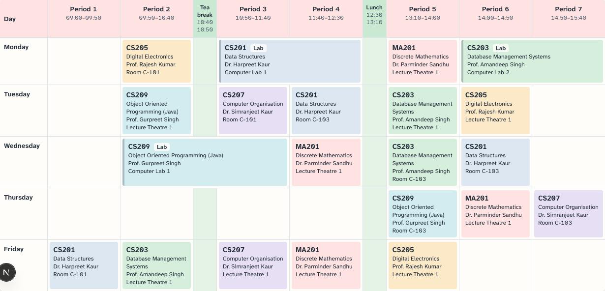
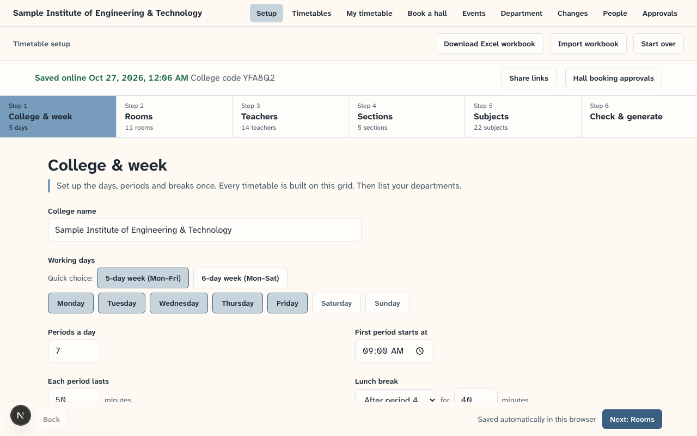
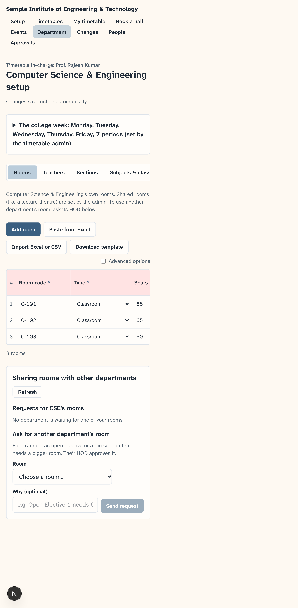
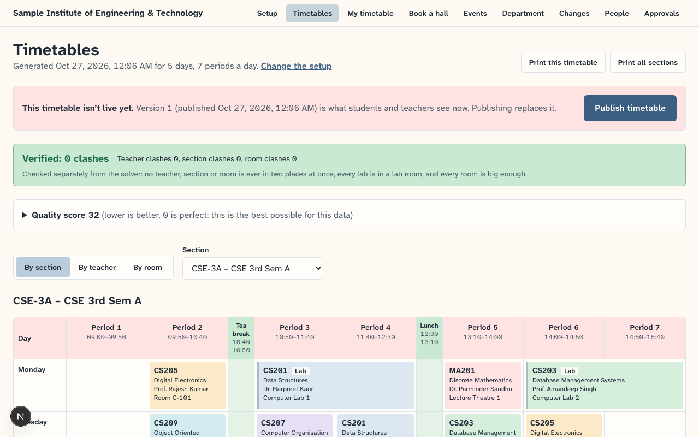
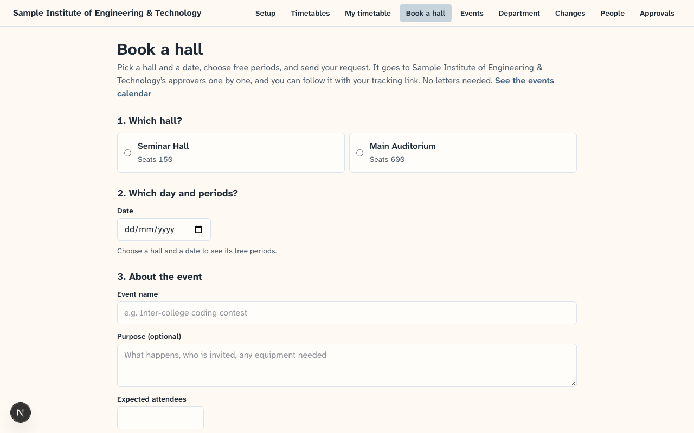
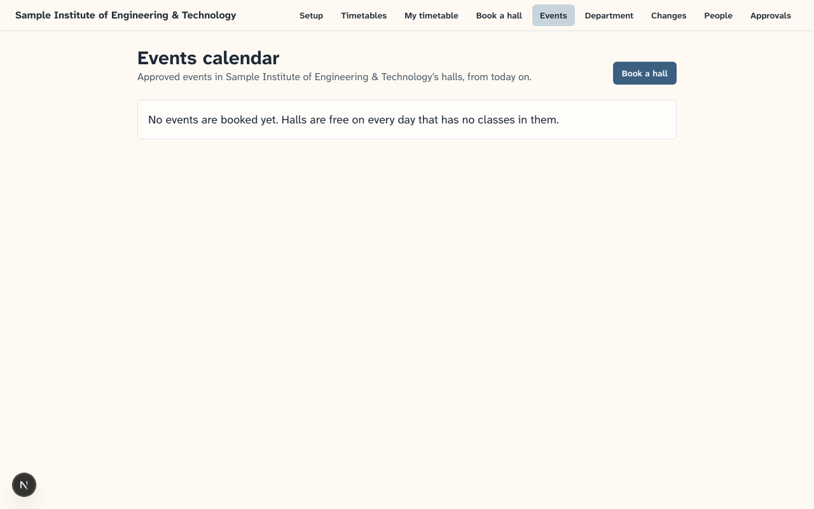

# College Timetable

**One place for the whole college.** Admins generate a clash-free timetable in minutes, teachers and students see their own week on their phones, departments run their own part of the setup, and clubs book seminar halls with digital approval instead of paper letters.

**Live demo:** <https://college-timetable-teal.vercel.app>. Click **Set up your college → Load sample college → Check & generate → Generate timetable**. The first visit may take up to a minute while the free server wakes up.

Built for the Punjab Jobs AI Bootcamp hackathon (J-PAL South Asia). It works for any college: nothing about days, periods, breaks, rooms or departments is hard-coded.



## Who it's for

| Person | What they get |
|---|---|
| **Timetable admin** (super admin) | A 6-step setup (or one Excel workbook), a timetable with **0 clashes, checked twice**, plain-English reasons when something can't fit, and one click to publish |
| **HOD** | Approves leave and room-sharing requests for their department, and appoints its timetable in-charge |
| **Timetable in-charge** | Edits only their department's rooms, teachers, sections and subjects, and marks it ready |
| **Teachers** | Their own week, today's classes, and leave requests |
| **Students** | Their section's week and a "Now / Next" card, from a share link or a 6-letter code. No login, nothing to change. |
| **Clubs and departments** | Book a seminar hall or auditorium in a free slot, follow the approval, and see the events calendar |

## What it does

- **Zero clashes, verified.** Google OR-Tools (CP-SAT) places every class so no teacher, section or room is ever double-booked. Labs are blocks of consecutive periods in the right lab, every room is big enough, and teachers' unavailable times are respected. An **independent checker** that shares no code with the solver re-checks every timetable, and its result is shown as **"Verified: 0 clashes"**.
- **Good timetables, not just valid ones.** A quality score keeps each subject spread across the week, avoids free periods between classes for students, limits long teaching runs, and balances teachers' days. Every part of the score is explained in plain words.
- **Any college.** Pick a starting template (Engineering, Arts & Science, or from scratch) and then choose:
  - your own working days (5-day or 6-day presets) and periods;
  - lunch and an optional tea break (and whether labs may run across it);
  - periods of different lengths;
  - your own room types.
- **Fast data entry.** Spreadsheet-style tables with paste-from-Excel, one Excel workbook for everything, row-by-row error messages, and codes that rename everywhere at once.
- **Explains what's wrong.** If no timetable is possible, it says exactly which resource is short and how to fix it, for example *"No classroom can hold the 66 students of Basics of IoT… Ask another department's HOD to share a big enough room."*
- **Open electives.** Students of several sections choose parallel subjects that run at the same time, each with its own teacher and room.
- **Room sharing between departments**, approved by the room's HOD, which the solver then uses.
- **Fair workload.** An optional "max periods a week" per teacher, and a warning when someone teaches far more than their department's average.
- **Department roles.** A super admin, plus HOD, timetable in-charge and teacher links. Each department edits only its own data, and the server enforces it.
- **Timetable views** by section, teacher and room, on a printable A4 page, and as a day-by-day list on phones. A student's **Today** card shows what's on now and next.
- **Hall booking with digital approval.** Only free slots are offered. The request moves through an approval chain (e.g. HOD → Dean), the organiser follows it with a tracking link, and approved events appear on a calendar.
- **Daily changes.** Teacher leave with HOD approval, substitute suggestions, and cancelled or moved classes shown on students' Today card.
- *In progress:* "Ask the timetable", a Claude-powered helper that answers questions like "Where is my next class?" from the real timetable.

## How an admin uses it, in 5 steps

1. **Start:** open the site → **Set up your college** → pick a template (or **Load sample college** to try it).
2. **Enter the college:** days, periods and breaks, then rooms, teachers, sections, subjects and *who teaches what*. Type, paste from Excel, or import the workbook. You can also give each HOD a link so departments enter their own part.
3. **Check & generate:** fix anything the checks point out (each problem has a "Fix in…" button), then press **Generate timetable**. You get "Verified: 0 clashes".
4. **Review:** look at every section, teacher and room, read the quality score, and print if you like.
5. **Save online & publish:** keep your private admin link safe, press **Publish timetable**, and share the 6-letter code or link with students and teachers.

## Screenshots

| Setup (desktop) | Department in-charge (phone) | My timetable (phone) |
|---|---|---|
|  |  |  |

| Timetables | Book a hall | Events calendar |
|---|---|---|
|  |  |  |

## How it's built

```
 Phones and laptops (students, teachers, HODs, admins, clubs)
            │
            ▼
 Next.js 16 + Tailwind (Vercel)         frontend/
   setup wizard · timetable views · my timetable · department setup
   hall booking · approvals · changes · Excel import (in the browser)
            │  HTTPS + JSON, NEXT_PUBLIC_API_URL
            ▼
 FastAPI (Render)                       backend/app/
   /generate /check /sample             colleges.py  (save, share, publish)
   bookings.py  changes.py              members.py   (HOD / teacher / in-charge links)
   departments.py (scoped setup, room sharing, ready flags)
            │                     │
            ▼                     ▼
 solver/ (pure Python)          Postgres (Supabase) via SQLAlchemy
   models.py   precheck.py      colleges, drafts, published timetables,
   cpsat.py    (OR-Tools)       bookings, leave, members, room requests
   diagnose.py checker.py
```

- **The solver is a pure module**: college data goes in, a timetable comes out. Hard rules are constraints; preferences are weighted penalties.
- **No passwords:** every role has a private link whose key lives after the `#` in the URL, so it never reaches server logs. Only a hash of each key is stored.
- More detail: [context.md](context.md) (design and decisions), [progress.md](progress.md) (build log), [CLAUDE.md](CLAUDE.md) (conventions).

## Run it locally

```bash
# Backend: http://localhost:8000
cd backend
python3 -m venv .venv && .venv/bin/pip install -r requirements-dev.txt
cp .env.example .env
.venv/bin/python -m uvicorn app.main:app --reload --port 8000
```

```bash
# Frontend: http://localhost:3000
cd frontend
npm install
cp .env.local.example .env.local
npm run dev
```

Without `DATABASE_URL`, the backend uses a local SQLite file.

### Tests

```bash
cd backend && .venv/bin/python -m pytest -q          # solver, checker, API, roles, bookings, leave
cd frontend && npm run lint && npm run build
cd frontend && npx playwright install chromium && npm run e2e   # real-browser tests
```

The end-to-end tests click through the main flows in a real browser:
- load the sample → generate → "Verified: 0 clashes";
- publish → a student opens the share link on a phone;
- a club books a hall → the admin approves → it appears on the events calendar;
- every page fits a desktop and a phone screen.

`UPDATE_SCREENSHOTS=1 npm run e2e` refreshes the screenshots in this README.

## Deploy

The backend goes on **Render** (free) and the frontend on **Vercel** (free). Order matters: Render first, because Vercel needs its URL, then back to Render to allow the Vercel URL.

### 1. Backend on Render
1. Go to <https://dashboard.render.com> and sign in with GitHub.
2. Click **New +** → **Blueprint**.
3. Under **Connect a repository**, pick `njain05/hackathon_1`. If it isn't listed (the repo is private), click **Configure account** / **Connect GitHub**, allow access to `hackathon_1`, and come back.
4. Render reads `render.yaml` and shows one service, **college-timetable-api** (free, Singapore). It asks for two values:
   - `FRONTEND_ORIGINS`: type `http://localhost:3000` for now. You'll replace it in step 3.
   - `DATABASE_URL`: your Supabase connection string. Use the **Session pooler** URI from Supabase → Project → **Connect** (Render can't reach Supabase's direct, IPv6-only address). If you don't have Supabase yet, type `sqlite:///./timetable.db` (works, but data is wiped whenever Render restarts).
5. Click **Apply**. The first build takes a few minutes (it installs OR-Tools).
6. When it says **Live**, copy the URL at the top, e.g. `https://college-timetable-api.onrender.com`.
7. Check it: open `<that URL>/health` in a browser. You should see `{"status":"ok"}`.

### 2. Frontend on Vercel
1. Go to <https://vercel.com/new> and sign in with GitHub.
2. Under **Import Git Repository**, find `hackathon_1` and click **Import**. If it isn't listed, click **Adjust GitHub App Permissions** and allow the repo.
3. **Root Directory**: click **Edit** and choose `frontend`. The framework shows **Next.js** automatically.
4. Open **Environment Variables** and add:
   - Name `NEXT_PUBLIC_API_URL`, value your Render URL from step 1.6, **without** a trailing `/`.
5. Click **Deploy**. When it finishes, copy your site URL, e.g. `https://hackathon-1-xyz.vercel.app` (shown under **Domains**).

If you forget the variable, the Vercel build stops with "NEXT_PUBLIC_API_URL is not set" on purpose. Add it under **Settings → Environment Variables**, then **Deployments → ⋯ → Redeploy**. The value is baked in at build time, so any change to it needs a redeploy.

### 3. Let the frontend talk to the backend
1. Back on Render, open **college-timetable-api** → **Environment**.
2. Edit `FRONTEND_ORIGINS` and set it to your Vercel URL from step 2.5, starting with `https://`, without a trailing `/`. To also keep local development working, use a comma: `https://hackathon-1-xyz.vercel.app,http://localhost:3000`.
3. Click **Save, rebuild, and deploy**.

### 4. Check the live site
1. Open the Vercel URL. The home page badge should say **Server connected** (the first visit may show "Waking up the server" for up to a minute).
2. **Set up your college → Load sample college → Check & generate → Generate timetable**. You should land on the timetables with **Verified: 0 clashes**.

### Good to know
- **The free Render server sleeps** after about 15 minutes without visitors. The next visit wakes it in up to a minute, and the site shows "Waking up the server, this can take up to a minute" meanwhile. Before a demo, open `<Render URL>/health` a couple of minutes early.
- **Every push to `main` redeploys both** Render and Vercel automatically.
- **Solver speed on the free plan**: Render's free server has about a tenth of a CPU, so `render.yaml` sets `SOLVER_WORKERS=2` (2 search threads beat 8 on a tiny CPU). Generating the sample takes about 20 seconds there, against about 5 on a laptop. A paid plan with more CPU is faster; then raise `SOLVER_WORKERS` to match its CPU count.
- **Vercel preview links** (from other branches) have different URLs that aren't in `FRONTEND_ORIGINS`, so they can't reach the backend. Use the production URL.
- **Troubleshooting**:
  - Saving or opening a college fails with a database message: open `<Render URL>/health/db`. It says `{"database":"ok"}` or why it can't connect, with the password hidden. *Can't load plugin: sqlalchemy.dialects:http* means you pasted Supabase's project URL (`https://xxxx.supabase.co`) instead of the connection string: use the **Session pooler** URI, which starts with `postgresql://`. *Network is unreachable* means you used Supabase's direct address: switch to the **Session pooler** URI. *password authentication failed* means the password in `DATABASE_URL` is wrong (if it contains `@ # / : ?`, reset it in Supabase to letters and numbers). After fixing `DATABASE_URL`, click **Save, rebuild, and deploy**.
  - Browser console says *blocked by CORS policy*: `FRONTEND_ORIGINS` doesn't exactly match the site's address (check `https://` and no trailing `/`).
  - Render build fails on the Python version: change `PYTHON_VERSION` in Render → Environment to the newest `3.12.x`.
- **Secrets** (`DATABASE_URL`, later `ANTHROPIC_API_KEY`) go only in Render's Environment page, never in the code or in a `NEXT_PUBLIC_` variable.

## Limitations and roadmap

- **Lab batches** (a section split into groups for labs) and **combined lectures** (two sections in one room) are designed in the data model but not built yet ([context.md](context.md), "College variations").
- **Free hosting is slow to wake and slow to solve.** The free Render server sleeps after 15 minutes (the site shows "Waking up the server") and has about a tenth of a CPU, so generating takes about 20 seconds there and may not reach the best possible score. It is still always clash-free. It takes about 5 seconds on a laptop.
- **Links instead of accounts.** Anyone holding a private link can use it, so share them privately; making a new link revokes the old one.
- **Next:** the "Ask the timetable" helper (in progress), calendar subscription links, an installable offline app for viewing, reports (teacher workload, room usage) and Excel export, and a one-command local college server (Docker).
