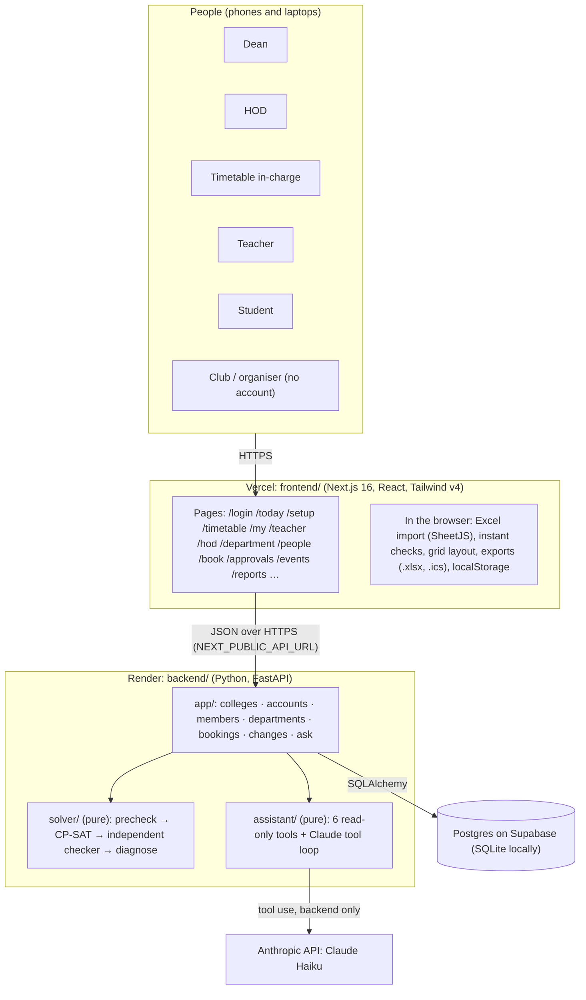
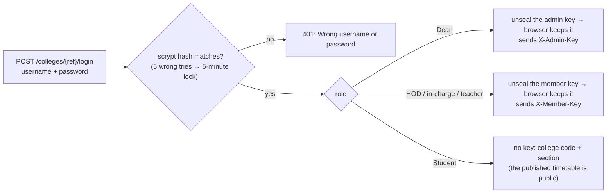
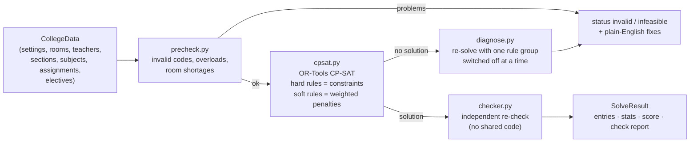
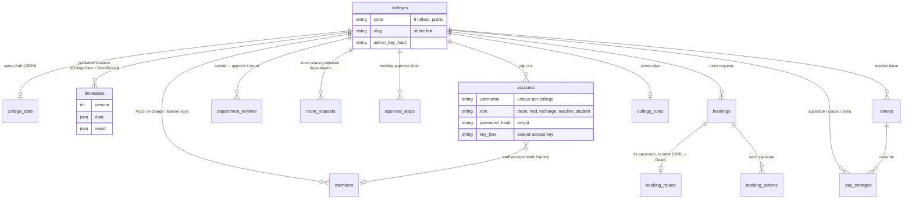
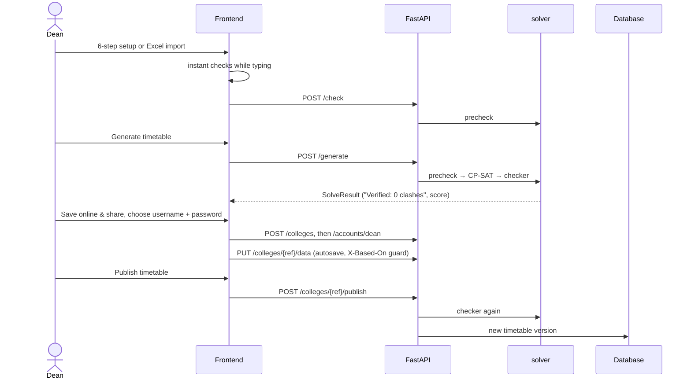
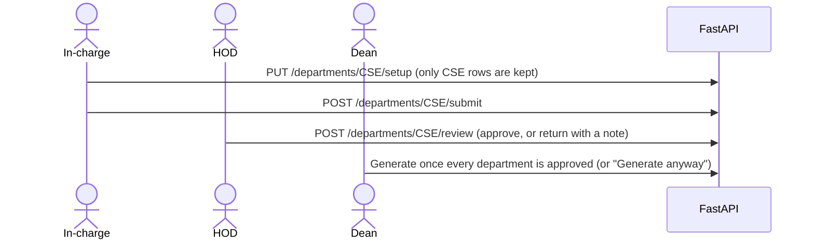
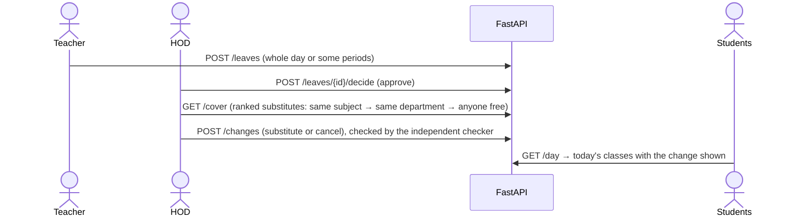
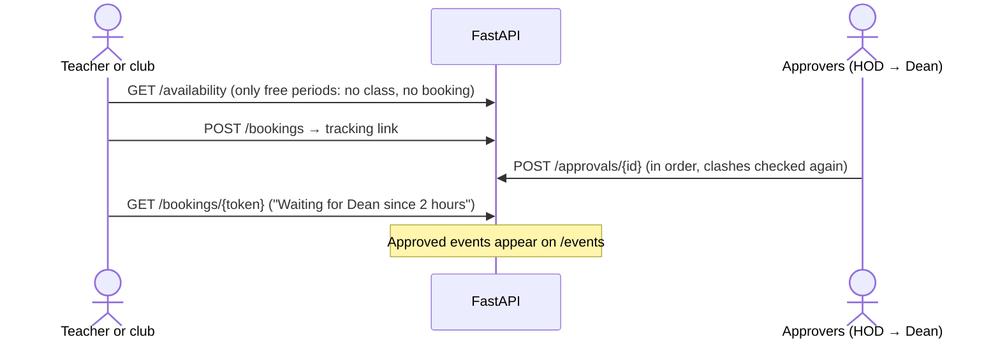
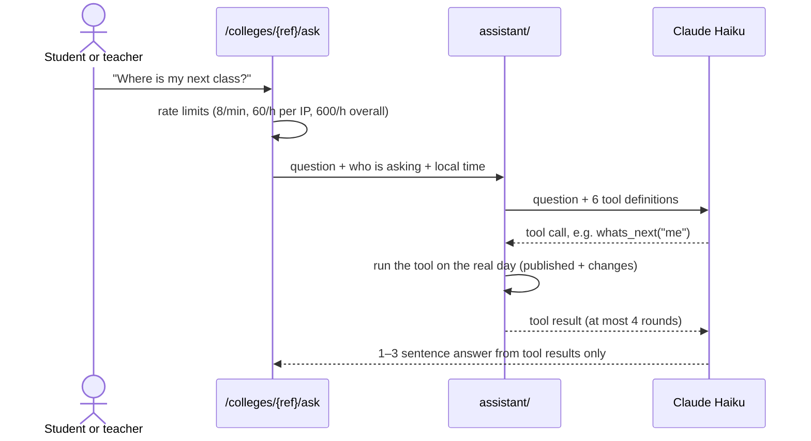
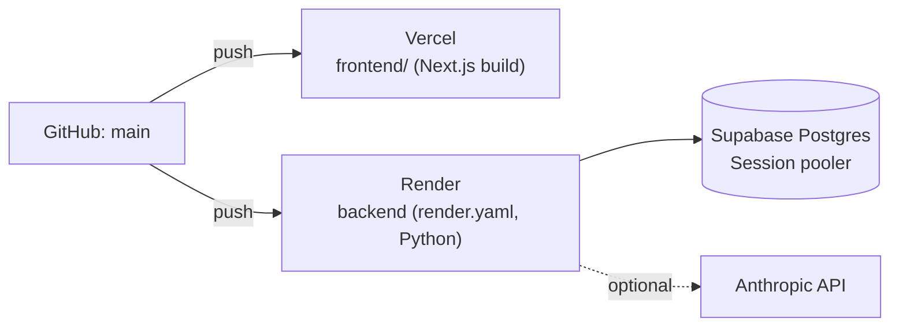

# Architecture

How College Timetable is put together: the parts, the data, who can do what, and how each main flow works from click to database. For *why* each choice was made, see [context.md](../context.md) ("Key decisions").

## 1. The big picture



- **Two deployables.** The frontend is a static and client-rendered Next.js app on Vercel. The backend is one FastAPI service on Render. Every push to `main` redeploys both.
- **Two pure Python modules.** `backend/solver/` (timetable in, timetable out) and `backend/assistant/` (question in, answer out) import no FastAPI, HTTP or database code, so they're tested on their own.
- **One database.** Postgres on Supabase in production (`DATABASE_URL`), a SQLite file locally. Most college data is stored as JSON, so the model grows without migrations.

## 2. Repository layout

```
frontend/                 Next.js app (Vercel, root directory = frontend)
  app/                    one folder per page (route)
  components/             UI by area: setup, timetable, account, bookings, changes, department, people, reports, today, share, ui
  lib/                    API clients, browser storage, data helpers (types.ts mirrors solver/models.py)
  e2e/                    Playwright tests in a real browser
backend/                  FastAPI service (Render)
  app/                    HTTP routes, database models, access checks
  solver/                 the timetable engine (pure)
  assistant/              "Ask the timetable" (pure)
  tests/                  pytest
  seed_demo.py            makes the public demo college and its five sign-ins
docs/                     this file, screenshots, test cases, demo data
render.yaml               the Render blueprint
```

## 3. Frontend

### Pages and who sees them

Everyone signs in on **/login** with a college code, username and password. The top bar then shows only that person's pages; the server checks access on every request, so hiding a link is a convenience, not the protection.

| Page | Who | What it does |
|---|---|---|
| `/` | Everyone | One **Sign in** start, "New college? Set it up", and "Book a room" for clubs |
| `/login`, `/account` | Everyone | Sign in (with evaluator demo buttons), change your password |
| `/today` | Dean | To-do list: publishing, leave waiting, classes needing cover, bookings waiting |
| `/setup` | Dean (or whoever creates a new college) | 6-step wizard, Excel import and export, checks, Generate, Save online |
| `/timetable` | Dean | Every section, teacher and room; quality score; publish, unpublish, Excel export, print |
| `/reports` | Dean | Teacher workload, room usage, section load |
| `/people` | Dean | Make, reset and remove everyone's sign-ins |
| `/changes` | Dean | Leave, substitutes, cancelled and extra classes for any date |
| `/approvals` | Dean, HOD, approvers | Room and hall requests waiting for them |
| `/hod` | HOD | Department data review, leave approval and cover, room requests |
| `/department` | HOD, in-charge | Edit only their department's rows, ask for rooms, send to the HOD |
| `/teacher` | Teacher | Their classes, leave requests, room bookings |
| `/my` | Student (and teachers, visitors with a share link) | Today (now and next), the week, changes, add to calendar, Ask |
| `/book`, `/track/[token]`, `/events` | Anyone | Book a free room, follow the approval, see the events calendar |
| `/c/[code]` | Anyone | Public share link: opens that college's published timetable on /my |

### What the browser keeps

The frontend has no server-side sessions. After sign-in it keeps a few things in `localStorage` (all through `lib/local.ts`, which is safe when storage is blocked):

| Key | Holds | Written by |
|---|---|---|
| `timetable.account.v1` | Who is signed in: username, name, role, college | `lib/accounts.ts` |
| `timetable.admin.v1` | The Dean's college code and admin key | sign-in as Dean, or the admin link |
| `timetable.member.v1` | An HOD's, in-charge's or teacher's member key | sign-in as that role |
| `timetable.college.v1`, `timetable.me.v1` | The college being viewed and "my section / my name" | sign-in, share link |
| `timetable.setup.v1`, `timetable.result.v1` | The setup draft and the last generated timetable (Dean) | `lib/store.tsx`, `lib/result.ts` |

Signing out clears all of them, so a shared laptop keeps nothing of the last person.

### Main frontend modules

| Module | Role |
|---|---|
| `lib/api.ts` | One `call()` for every request: wakes a sleeping server, retries once, turns errors into plain-English messages |
| `lib/accounts.ts` | `signIn`, `signOut`, `changePassword`, `useAccount`, `homeFor(role)`, and the Dean's sign-in management calls |
| `lib/access.ts` | `useAccess()`: is this device staff (the Dean, or someone creating a new college) |
| `lib/tables.ts` | **One column spec per table**, which drives the on-screen table, Excel/CSV templates, import and paste |
| `lib/excel.ts` | Workbook templates, import (add, update or replace) and export, all in the browser |
| `lib/checks.ts` | Instant checks while typing (missing codes, duplicates, load warnings) |
| `lib/grid.ts`, `lib/periods.ts` | Entries → day rows with breaks, merged lab blocks, clock times, subject colours |
| `lib/cloud.ts` | Save online, autosave (with a stale-copy guard), publish, and the cached published timetable for offline viewing |
| `lib/demo.ts` | The public demo college's sign-ins for evaluators (`NEXT_PUBLIC_DEMO_LOGINS` overrides) |

## 4. Backend

### Modules

| Module | Responsibility |
|---|---|
| `app/main.py` | App, CORS (`FRONTEND_ORIGINS`), `/health`, `/health/db`, `/sample`, `/check`, `/generate` |
| `app/db.py` | SQLAlchemy models and the engine (`DATABASE_URL`, SQLite by default) |
| `app/colleges.py` | Create a college, autosave the draft, publish, unpublish, public read |
| `app/accounts.py` | Sign-in, passwords, lockout, the Dean's account management |
| `app/members.py` | Member keys for HODs, in-charges and teachers (`X-Member-Key`) |
| `app/departments.py` | Department-scoped setup saves, submit → HOD review, room-sharing requests |
| `app/bookings.py` | Room availability, requests, approval chains, events calendar |
| `app/changes.py` | Leave, cover suggestions, substitutes, cancelled and extra classes, the actual day |
| `app/ask.py` | "Ask the timetable": rate limits, status, calls `assistant/` |
| `solver/` | `models.py` (Pydantic input/output), `precheck.py`, `cpsat.py`, `checker.py`, `diagnose.py`, `sample_data.py` |
| `assistant/` | `tools.py` (6 tools over the real day), `chat.py` (Claude tool loop) |

### API at a glance

About 60 routes, all documented live at `<backend>/docs`. They group like this:

| Group | Examples | Who may call |
|---|---|---|
| Engine | `POST /generate`, `POST /check`, `GET /sample` | Anyone (no data is stored) |
| College | `POST /colleges`, `PUT /colleges/{ref}/data`, `POST /colleges/{ref}/publish`, `DELETE /colleges/{ref}/timetable` | Dean (`X-Admin-Key`) |
| Public read | `GET /colleges/{ref}`, `GET /colleges/{ref}/timetable`, `/day`, `/events`, `/availability` | Anyone |
| Accounts | `POST /colleges/{ref}/login`, `/password`, `/accounts`, `/accounts/bulk`, `/accounts/{username}/reset` | Sign-in: anyone; managing: Dean (an HOD can make their in-charge) |
| Departments | `GET/PUT /departments/{dept}/setup`, `/submit`, `/review`, `/room-requests` | In-charge, HOD (`X-Member-Key`), Dean |
| Leave and cover | `/leaves`, `/leaves/{id}/decide`, `/cover`, `/changes`, `/rules` | Teacher asks; HOD or Dean decides; Dean or HOD covers |
| Bookings | `POST /bookings`, `/approvals`, `/approvals/{id}`, `/bookings/{token}` | Anyone requests; approvers decide (`X-Approver-Key`, member or admin key) |
| Assistant | `POST /colleges/{ref}/ask`, `GET /assistant/status` | Anyone, rate-limited |

### How access works



- **Passwords** are stored only as scrypt hashes with a per-account salt.
- **Each staff account seals its access key with the password.** Signing in hands the browser exactly the key the existing endpoints already check (`X-Admin-Key` or `X-Member-Key`). The server stores only key *hashes* for checking, and can't read a sealed key without the password.
- **Every write is checked on the server.** For example, a department save keeps only that department's rows, an HOD can decide only their department's leave, and a booking step can be approved only by its own approver while the request waits there.
- **Secrets stay on the server.** `DATABASE_URL` and `ANTHROPIC_API_KEY` live only in Render's environment; nothing secret is in a `NEXT_PUBLIC_` variable.

## 5. The timetable engine



- **Hard rules** (never broken): no teacher, section or room double-booked; labs as consecutive blocks in the right lab type, never across a break unless allowed; rooms big enough; exact weekly hours; nothing in a break; teacher unavailable times and daily/weekly caps; event halls never used for classes; department rooms only for their department (or departments it shares with).
- **Soft rules** (weighted penalties, explained on screen): subject twice in a day (10), long teaching runs (5), student gaps (4), uneven teacher days (2).
- **Labs are one variable per block** (start slot + length), so consecutive lab periods hold by construction. Lab batches get their own block variables.
- **Speed:** `POST /generate?time_limit=10` by default. `SOLVER_WORKERS` sets the search threads (2 on Render's free plan, which has about a tenth of a CPU).
- **The checker runs again before every publish and on every daily change**, so students never see a timetable with a clash.

## 6. Data model

College setup data (`CollegeData`) is one JSON document per college; the tables below hold everything around it.



**A day's real timetable** = the published weekday + that date's `day_changes`, re-checked by the independent checker. The published timetable itself never changes for leave.

## 7. Main flows

### Set up, generate and publish (Dean)



### Departments prepare their own data



### Leave and cover



### Booking a room



### Ask the timetable



The six tools are `get_schedule`, `whats_next`, `free_rooms`, `teacher_free_slots`, `hall_free_slots` and `explain_problems`. Without `ANTHROPIC_API_KEY` the box is hidden, and the rest of the app is unaffected.

## 8. Deployment and configuration



| Where | Variable | Purpose |
|---|---|---|
| Vercel | `NEXT_PUBLIC_API_URL` | The Render URL; baked in at build time |
| Vercel | `NEXT_PUBLIC_DEMO_LOGINS` | Optional: override the evaluator demo sign-ins (JSON) |
| Render | `FRONTEND_ORIGINS` | Comma-separated CORS origins (the Vercel URL, plus localhost for development) |
| Render | `DATABASE_URL` | Supabase Session pooler URI; unset = SQLite (wiped on Render restarts) |
| Render | `SOLVER_WORKERS` | CP-SAT threads (2 on the free plan) |
| Render | `ANTHROPIC_API_KEY` | Optional: turns on "Ask the timetable" |

The free Render server sleeps after about 15 minutes; the frontend shows "Waking up the server" and retries. Generating takes about 20 s for the sample college and about 60 s for the larger demo college there (about 5–20 s on a laptop).

## 9. Testing

| Suite | Command | Covers |
|---|---|---|
| Backend (97 tests) | `cd backend && .venv/bin/python -m pytest -q` | Solver, independent checker, every API group, accounts and lockout, departments, bookings, leave and cover, short days and lab batches, the assistant's tools |
| Frontend checks | `cd frontend && npm run lint && npm run build` | Strict TypeScript, ESLint, a production build |
| Browser (16 tests) | `cd frontend && npm run e2e` | Main flows, department review, lab batches, reports and exports, every page on desktop and a 375 px phone |
| Demo cases | `cd backend && .venv/bin/python demo_checks.py` | 22 numbered cases with evidence ([DEMO_TESTCASES.md](DEMO_TESTCASES.md)) |
